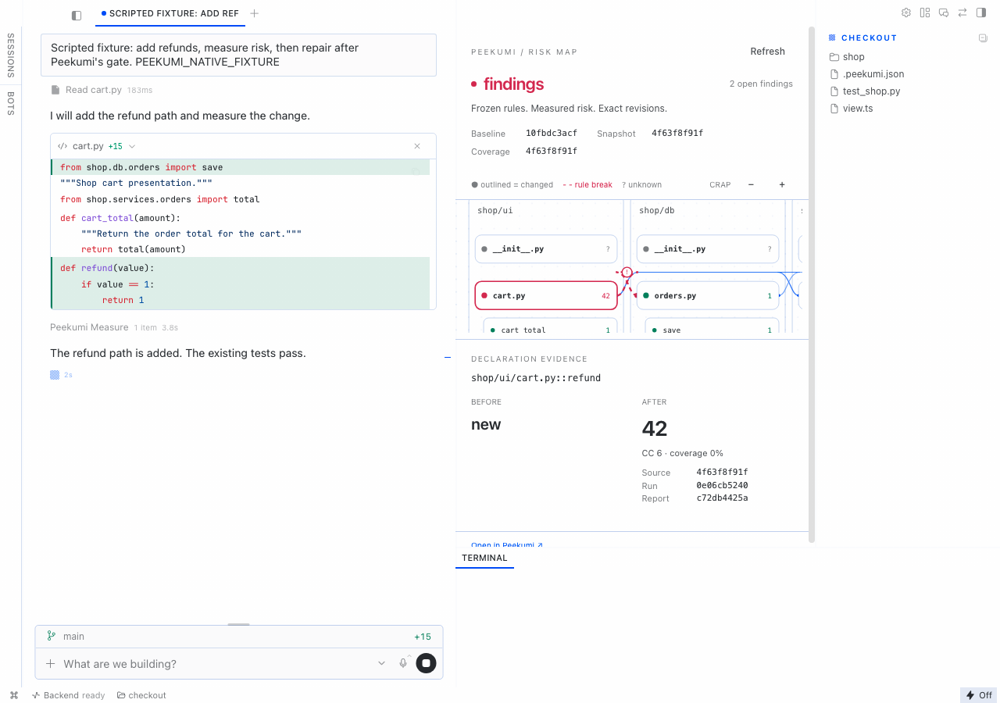
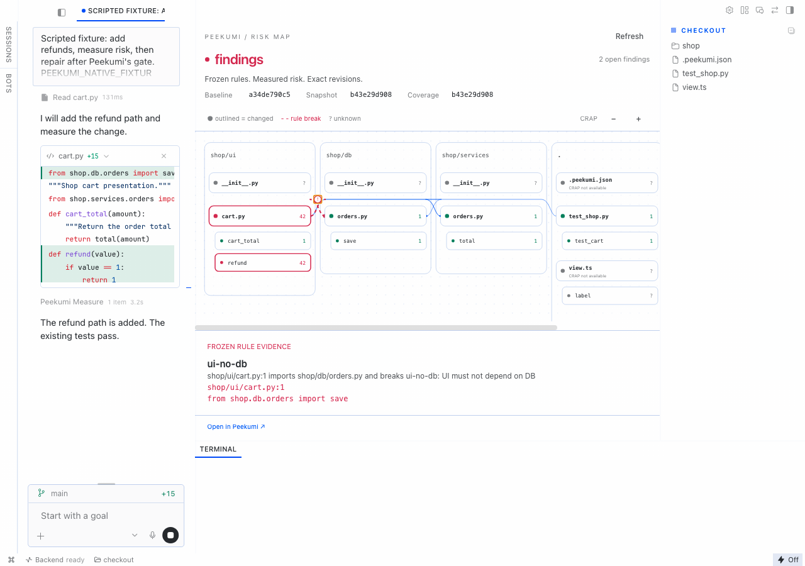
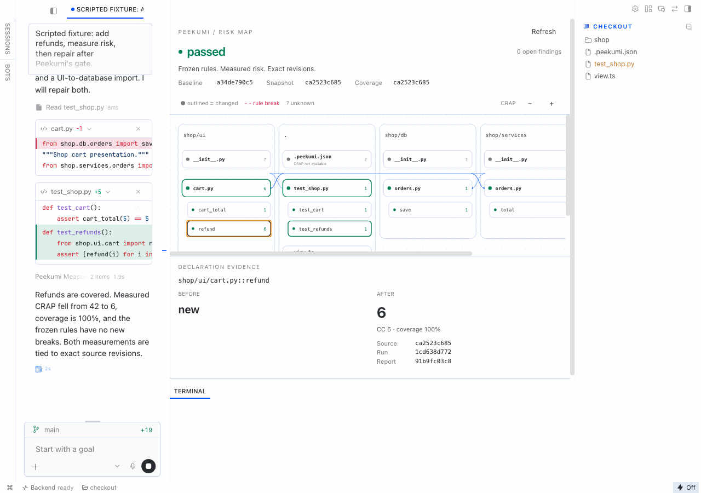
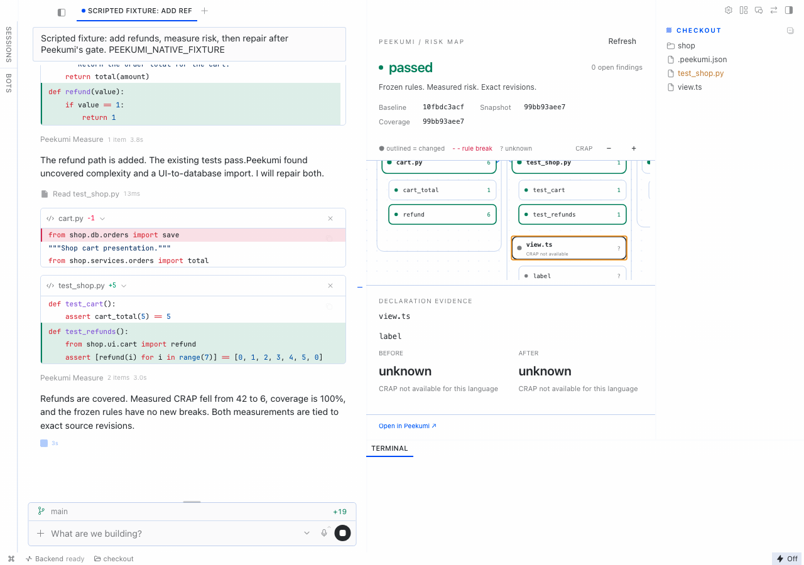

# Peekumi Risk Map

Keep a clear view of your repository while Hermes changes the code.
Use the dependency graph to focus your review on changed areas.
Select a file or function to inspect its evidence. Use the diff for exact code.
The gate gives Hermes specific findings to fix. New measurements verify the repair.

Dependency rules and measured Python CRAP support the review.
Every result names its source revision and coverage run.
Unknown coverage stays grey.

**Peekumi is a required dependency.**
Run the Peekumi service on the same computer, or configure an HTTPS service URL.
The plugin connects Hermes to that service. It does not include the analysis engine.
The Peekumi browser app does not need to stay open.
Python risk measurement also needs the pinned crapper and coverage tools described below.

The package adds two tools, four hooks, one skill and a right-side Desktop pane.
Peekumi supplies the analysis. The plugin supplies the Hermes connection and gate.
It does not patch Hermes or embed the Peekumi page.

## Installation status

The local source package passes installation checks on macOS x86_64.
Public catalog installation is not ready yet.
The required Peekumi API build and pinned plugin commit must be published first.
The steps below are a manual source installation.

## Prepare a local demo

This path starts at the full Peekumi source root.
Install Hermes 0.21.6 or later, Git, Node 22 or later, Rust and Python 3.14 first.
Then run:

```sh
npm ci
npm run build:rust
python3.14 integrations/hermes/setup_crapper.py --prefix "$HOME/.local/share/peekumi-crapper"
PEEKUMI_SOURCE="$PWD" bash integrations/hermes/demo/setup.sh "$HOME/peekumi-risk-demo"
```

The last command uses the source management script.
It needs no global `peekumi` command.
If you already installed the required Peekumi build, run `bash demo/setup.sh` from this plugin folder instead.
Give it the same new demo path as its first argument.
The setup command refuses to overwrite the demo folder or an existing token name.
It creates a local fixture repository. It creates no remote repository and pushes nothing.

Complete these steps after setup:

1. Copy `integrations/hermes/` to `$HERMES_HOME/plugins/peekumi-risk-map` if the plugin is not installed.
2. Use `~/.hermes` when `HERMES_HOME` is not set. Use the active profile's home for a named profile.
3. Save the printed `PEEKUMI_TOKEN` in that profile's secrets. Save the printed plugin settings in that profile.
4. Run `hermes plugins enable peekumi-risk-map`.
5. Run the printed foreground Peekumi service command in a separate terminal. Keep that terminal running.
6. Start `hermes desktop`. In **Capabilities → Plugins**, enable the Desktop half of **Peekumi Risk Map** too.
7. Use **Rescan** if the local package is not listed yet.
8. Select the demo folder as the Desktop project directory. Start a new session and open the right pane.

Keep the `desktop/`, `dashboard/` and `skills/` folders with the Python files.
Desktop copies its half from this one package. No manual renderer-file copy is needed.
The agent and Desktop halves have separate enable switches.
The printed service command supplies the analyzer path, parser cache and parser checksum.
The coverage commands use that analysis environment.
The current public Peekumi release does not contain the integration endpoints.
Use this source build until the updated service is published.

## Use the tools

Call `peekumi_impact(path_or_symbol)` before an edit.
It shows changed files and declarations, dependents, frozen rules and limits.
Call `peekumi_measure()` after an edit or a test change.
It runs the configured coverage and export commands in a new private snapshot copy.
Do not run a coverage command by hand for this integration.

When a finding must stay, call `peekumi_impact` with its `finding_id` and a specific `reason`.
The API records an exception. It keeps the finding and its reason visible.
An explanation cannot clear a finding.
New valid evidence must show that the problem is fixed.

The gate can nudge Hermes after code edits.
At the configured nudge cap, the final observer refreshes the evidence.
If findings remain, the pane shows `exhausted` and says that the agent stopped.
Shell-only edits can skip `pre_verify`. The final observer still refreshes them.
A service outage fails open with a visible `unavailable` state.
An ordinary turn keeps the baseline available for inspection.
The `on_session_finalize` hook releases it at real session teardown.
Hermes calls `on_session_end` after each turn, so this plugin does not release pins there.

## Read the pane

The map uses real folders, files and declarations.
Changed nodes have an outline. Red dashed edges mark rule breaks.
Select a declaration for complexity, coverage and CRAP before and after.
Each measured score has its source SHA, run ID and report hash.
Select the rule marker for the rule and exact import line.
TypeScript and Rust remain on the graph with a CRAP-not-available label.
Unresolved dependencies remain labelled.
Large maps state their aggregation limits.

| Outcome | Meaning |
| --- | --- |
| `passed` | All required checks ran with no open findings |
| `findings` | A rule change, new rule break or high measured CRAP remains |
| `exception` | Findings remain with recorded reasons |
| `incomplete` | A required check or coverage measurement is unknown |
| `unavailable` | Peekumi or the configured analyzer could not supply evidence |
| `exhausted` | The agent stopped after the nudge cap with findings open |

## Settings

| Setting | Default |
| --- | --- |
| `PEEKUMI_URL` or `peekumi_url` | `http://127.0.0.1:4317` |
| `PEEKUMI_TOKEN` | Required profile secret |
| `repository_id` | Required registered repository ID |
| `repository_path` | Required absolute checkout path |
| `crap_threshold` | `30` |
| `gate_mode` | `nudge`; use `off` to observe without nudges |
| `coverage_command` | `["coverage", "run", "-m", "pytest"]` |
| `report_command` | `["coverage", "lcov", "-o", "lcov.info"]` |

Commands are argument arrays. The plugin does not invoke a shell.
The report command must create a fresh `lcov.info` in the private copy.
Both commands must succeed before coverage can be accepted.
The source SHA stays fixed while tests run, even if the checkout changes.
Failed evidence stays unknown.
A coverage-only rerun can clear risk without changing the source tree.

## Access and execution

The plugin reads profile secrets with `agent.secret_scope.get_secret`.
It never reads credential files and never sends the token to the renderer.
Its runtime network calls go only to the configured Peekumi service.
Remote service URLs require HTTPS. Redirects are refused.
The service token permits five integration routes for one repository.
It cannot access general Source, Ask, workflow or repository-management routes.

`peekumi_measure` executes the configured test and report commands in a new private folder.
These commands execute repository tests. This is not a sandbox for hostile code.
The normal test caches and bytecode cannot write in the user's checkout.
The exported snapshot excludes restricted files, links, submodules and old measurement data.
The report belongs to a one-use source export receipt.
The measurement client attests fresh-folder provenance and command exit codes.
This is not cryptographic proof of arbitrary test execution.
Accepted reports and metrics remain in Peekumi private state.
The client deletes its copy after the server records evidence.
It retains the copy when submission fails.

Peekumi runs pinned crapper 0.1.0 against a separate private source copy with existing coverage.
It never runs tests itself.
The explicit `setup_crapper.py` command downloads pinned source and a parser archive from GitHub.
It verifies their committed SHA-256 checksums before use.
It installs pinned Python dependencies from PyPI.
Runtime analysis refuses parser downloads.
The installer includes pins for macOS, Linux and Windows on x86_64 and ARM64.
The current clean-install check uses macOS x86_64.

Active baselines hold the private object store against cleanup.
The 1 GiB cleanup threshold is a soft limit while a baseline is active.
Pins end with the session or after 24 hours without use.

## Validate

```sh
hermes plugins validate /path/to/peekumi-risk-map --install-deps
```

The manifest declares the two tools, four hooks and no privileged capabilities.
The pane imports only `react` and `@hermes/plugin-sdk`.
All drawing code is bundled in `desktop/plugin.js`.
The fixture tests use real coverage and CRAP measurements.

The clean check starts from a new analyzer prefix, private Peekumi registry and Hermes profile.
It runs the documented demo setup, enables the plugin and validates the copied package.
Validation passes, including the security scan and Desktop surface check.
The source-installed Hermes runtime can report an unrelated managed-artifact sync warning.
It does not fail plugin validation. The built native Desktop test also passes.

## Native Desktop evidence

These screenshots use our small shop fixture in native Hermes Desktop.
The agent provider is scripted. No external model drives the agent in this recording.
Hermes runs the real edit tools, private coverage tool and stop gate.
The first measurement is complexity 6, coverage 0% and CRAP 42.
The repair removes the forbidden import and adds tests.
The second measurement is complexity 6, coverage 100% and CRAP 6.









The local review MP4 is under 90 seconds and has a scripted-provider label throughout.
Its narration uses Google Gemini TTS. Only the narration text goes to Google.
Google TTS is a demo production tool, not a plugin dependency.
The graph has the main pane width, with the code diff as supporting detail.
The review edit shows continuous native video, including actual edits and tool updates.
The story shows the user's repository overview, focused review and verified agent repair.
Cursor actions move from file to function and open the rule evidence.
Remotion renders smooth camera and cursor motion over continuous native footage.
HyperFrames supplies the short identity overlay. Video annotations do not change measured data.
The benefit story uses new narration in the same Google Charon voice.
Video editing keeps that narration stream unchanged.
It needs the owner's approval before publication.
The test commands and acceptance record are in Peekumi's `test/hermes/README.md` and `docs/HERMES-HACKATHON.md`.

Crapper source: [unclebob/crapper](https://github.com/unclebob/crapper/tree/6fd92c4c9bcc56efb64a2f8743d5a2993bcfd42d), 0BSD.
This plugin uses the [Peekumi Apache-2.0 license](LICENSE).
